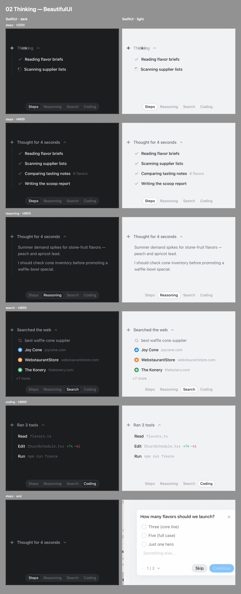
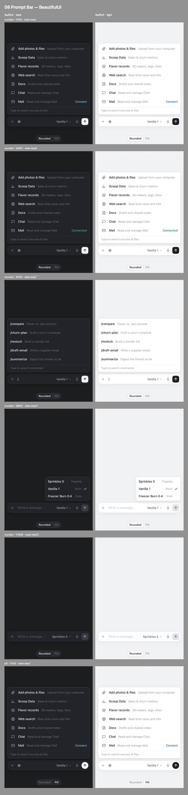

# BeautifulUI

[Beautiful UI](https://www.beautifului.dev/)（Turbo 的 AI-native 界面原语）的 SwiftUI 移植：21 个组件全部完成，另有 token 层和一个 Catalog 演示 App。

- Swift Package，iOS 26 起；macOS 26 也能编译和跑 SwiftUI 预览。不依赖第三方库。
- 组件由数据驱动，不内置演示数据；冰淇淋主题的示例数据只在 Catalog 里。
- 深浅色自动切换；文字随 Dynamic Type 缩放；开启“减少动态效果”时，循环动画会停下。
- 每个组件都有和原站并排的对比图，在 [`compare/`](compare)。

## 目录

| 路径 | 内容 |
|---|---|
| `BeautifulUI/` | Swift Package：`Tokens/`（颜色、字体、间距、圆角、阴影、动效）、`Support/`（共用小件）、`Components/`（每个组件一个文件）、`Tests/` |
| `Catalog/` | 演示 App，XcodeGen 生成工程（`project.yml`，`.xcodeproj` 不入库） |
| `compare/` | 对比图（JPEG）：每行一个状态，四列依次是原站深色、SwiftUI 深色、原站浅色、SwiftUI 浅色 |
| `docs/tokens.md` | 从原站 CSS 读出的设计 token：深浅两套颜色（oklch 换算成 sRGB）、圆角、阴影、缓动曲线和关键帧 |
| `tools/` | 编译安装 Catalog、模拟器截图、拼对比图、录走查视频的脚本；本地产物都写进不入库的 `verify/` |

## 用法

在 Xcode 里用 “Add Package Dependencies…” 添加本地路径 `BeautifulUI`，或者在 `Package.swift` 里写：

```swift
.package(path: "../beautiful-ui-swift/BeautifulUI")
```

```swift
import BeautifulUI

// 长任务的状态行
LoadingState("Churning", pattern: .drive)

// 思考过程：由 isWorking 和已到达的行驱动
ThinkingState(.steps, isWorking: agent.isThinking, doneTitle: "Thought for 4 seconds",
              rows: agent.steps.map { ThinkingRow($0.title) })

// 流式回答：token 逐个追加，引用显示为行内来源 chip
StreamingText(tokens: answer.tokens, isStreaming: answer.isStreaming,
              sources: answer.sources, followUps: answer.followUps,
              onFollowUp: { prompt, _ in send(prompt) })

// 输入框：可变状态放在一个 @Observable 模型里，由宿主持有
@State var composer = PromptBarModel(selectedModelID: "sprinkles-5")
PromptBar(model: composer, sources: sources, commands: commands, models: models,
          onSend: { send($0) })
```

### 主题

组件从环境里读 `BUITheme`（颜色 `BUIColors` 加圆角 `BUIRadii`），默认是原站配色。宿主可以整体替换：

```swift
RootView()
    .buiTheme(BUITheme(colors: myColors, radii: BUIRadii(control: 10, card: 14)))
```

文字样式用 `BUITextStyle`，按原站的 px 一比一换成 pt。默认字号下尺寸和原站一致，字号会随系统设置缩放（13pt 跟 `.footnote` 走，12pt 跟 `.caption` 走）。

### 给宿主 App 的接口

把组件放进一个已有的 App时用得上：

```swift
RootView()
    .buiTheme(BUITheme(colors: myColors, radii: myRadii,
                       typeScale: 1.2,     // 原站是桌面字号（标签 13pt），手机正文 17pt 的 App 设 1.15–1.2
                       entrances: false))  // 列表滚动会重建行时关掉入场动画，否则打开一段历史时每行同时淡入
```

- **字形**：宿主在外层设了 `.fontDesign`（比如整个 App 用圆体）时，`buiFont` 的默认字形跟着宿主走，等宽和圆体的样式保持自己的字形。
- **Thinking**：`ThinkingState(…, maxWidth:)` 可以撑满宽度（默认 380pt）。收起时不构建正文，出现时不起 task、不挂入场动画，适合放进懒加载列表，每条思考一行。
- **Tool Chips 拆开用**：
  - `ToolChipRow(call, isOpen:, isRunning:, chipStyle:, action:) { 右侧附加视图 }`：一个调用一行，给每步单独成行的列表。展开内容由宿主画。`chipStyle: .plain` 去掉参数的底框。
  - `ToolCall.Kind.symbol("terminal")` 用 SF Symbols 作图标。
  - `ToolChipGroup(chips, isOpen:, isRunning:)`：把一段连续的调用合成一行 chip，比如「Read 3 files · Edit Provider.swift +6 −3」。每种工具一个 chip，`BUIFlowLayout` 换行，chip 数和调用数无关。点按和展开由宿主处理。
- **Code Block 的 diff**：`CodeBlock(filename:diff:additions:deletions:maxWidth:elevation:onTitleTap:)`。
  - `additions` / `deletions`：只传一段节选时，标题上的计数用这两个值。
  - `elevation: .hairline`：放在别的卡片里时去掉阴影。
  - `onTitleTap`：让文件名可以点。
  - 所有行都没有行号时，不画行号栏。

## Catalog

```sh
tools/build-catalog.sh   # xcodegen + xcodebuild + 安装到本项目的模拟器（verify/sim-udid.txt）
```

- 首页是 Gallery：按原站顺序，在一页里滚动展示全部组件的实时演示（用 LazyVStack，屏幕外的演示不跑动画）。点右上角的放大按钮单独打开一个组件。右上角还能切换到列表视图。
- 每个组件页的外观和原站的一节一样：编号标题、canvas 色演示区、底部的变体切换按钮；右上角可以重播，或者跳到下一个组件。
- 启动参数（截图和录屏用）：`-component <id> -variant <名字> -theme dark|light -state <状态>`。例如 `-component approval-card -state q2` 会直接打开审批卡的第二题。
- `CatalogUITests/WalkthroughTests` 是一段脚本化的走查（深色走完 21 个组件，浅色再走 3 个）；`tools/record-walkthrough.sh` 边跑边录屏。
- `tools/compare-all.sh` 用当前代码重新生成全部对比图。原站那一侧的截图在本地 `reference/shots/`，不在仓库里（是别人网站的内容），所以 clone 下来的仓库只能重拍 SwiftUI 这一侧。

## 组件清单

点组件名看它的对比图。对比图里的“原站”指 402pt 宽（iPhone 17 Pro）下的原站页面。下面是其中两张：






| # | 组件 | Swift 类型 | 状态 | 和原版的差异 |
|---|---|---|---|---|
| 01 | [Loading State](compare/01-loading-state.jpg) | `LoadingState`、`PixelLoader` | ✅ | Surfer 变体里的视频换成可以传入任意视图的预览卡（Catalog 用原站自己的 “Video unavailable” 兜底样式） |
| 02 | [Thinking](compare/02-thinking-state.jpg) | `ThinkingState` | ✅ | 原版用内部计时器推进，这里改成由 `isWorking` 和已到达的行驱动；搜索结果点按打开链接 |
| 03 | [Streaming Text](compare/03-streaming-text.jpg) | `StreamingText` | ✅ | 行内来源 chip 画在文字后面，正文是单个 `Text`（中文也能正常换行）；chip 没有单独的 pop-in 动画 |
| 04 | [Approval Card](compare/04-approval-card.jpg) | `ApprovalCard` | ✅ | 选项的滑动悬停高亮改成按下高亮；步数用数字滚动过渡 |
| 05 | [Tool Chips](compare/05-tool-chips.jpg) | `ToolChips`、`ToolChipRow`、`ToolChipGroup` | ✅ | 悬停改为点按：点一行展开详情，点文件 chip 在其下方浮出 diff 预览；另有单行和合组两种拆开用法（见「给宿主 App 的接口」） |
| 06 | [Task Rows](compare/06-task-rows.jpg) | `TaskRows` | ✅ | 悬停底色改为按下底色 |
| 07 | [Chat](compare/07-chat-composer.jpg) | `ChatPanel` | ✅ | 和原版一致 |
| 08 | [Prompt Bar](compare/08-prompt-bar.jpg) | `PromptBar`、`PromptBarModel` | ✅ | 状态放在 `@Observable` 模型里；彩虹扫光用渐变光带代替原版的 WebGL shader；方向键和 Esc 的键盘操作没做；模型菜单宽 184pt（原 176，SF 字体更宽） |
| 09 | [Recommendation Card](compare/09-recommendation-card.jpg) | `RecommendationCard` | ✅ | 和原版一致；行内的实体和数值胶囊画在文字后面 |
| 10 | [Context Cards](compare/10-context-cards.jpg) | `ContextCards` | ✅ | 和原版一致 |
| 11 | [Diff Table](compare/11-diff-table.jpg) | `DiffTable` | ✅ | 悬停变暗改为按下变暗；提示文案从 “Click” 改为 “Tap” |
| 12 | [Records Table](compare/12-records-table.jpg) | `RecordsTable` | ✅ | 去掉拖动调列宽；属性设置弹层精简为提示词、排序和运行；横向滚动时公司列收窄到 120pt，手机上才看得到其他列 |
| 13 | [Filter Table](compare/13-filter-table.jpg) | `FilterTable` | ✅ | 和原版一致 |
| 14 | [Sidebar Nav](compare/14-sidebar-nav.jpg) | `SidebarNav` | ✅ | 原版的图标库换成 SF Symbols（冰棍图标自己画）；滑动悬停高亮改为按下底色 |
| 15 | [Search](compare/15-search.jpg) | `SearchList` | ✅ | 和原版一致 |
| 16 | [Flowchart](compare/16-flowchart.jpg) | `Flowchart` | ✅ | 和原版一致（拖动卡片，连线跟随） |
| 17 | [Insight Cards](compare/17-insight-cards.jpg) | `InsightCards` | ✅ | 原版的 Liveline 图表库换成 Canvas 自绘，横向拖动查看数值 |
| 18 | [Code Block](compare/18-code-block.jpg) | `CodeBlock` | ✅ | 和原版一致；iOS 的断行策略和浏览器不同，个别行的换行位置不一样 |
| 19 | [Fine-tune Card](compare/19-fine-tune-card.jpg) | `FineTuneCard` | ✅ | 直接拖标签调数值（原版要先悬停出 ↔ 光标）；方向键微调没做 |
| 20 | [Selection Actions](compare/20-selection-actions.jpg) | `SelectionActions` | ✅ | 手机宽度下输入框会收窄，展开后的操作在条内横向滚动，不会溢出；原版的 iconoir 图标换成 SF Symbols |
| 21 | [Agent Screen](compare/21-agent-screen.jpg) | `AgentScreen` | ✅ | 原站的桌面截图换成仿窗口占位视图（可以传入任意屏幕视图）；Open 按钮在按下时出现；查看器用全屏覆盖层 |

### 全局差异（Web 和 iOS 习惯不同的地方）

- **字体**：原站用 Inter 和 JetBrains Mono，这里用 SF Pro 和 SF Mono，库里不打包字体。SF Mono 的字宽是 0.618em，JetBrains Mono 是 0.6em，所以等宽字默认收紧 0.03em 字距，让宽度和换行位置对齐。
- **行高**：CSS 的 line-height 会在每行上下各留半个行距。`buiFont` 给多出来的部分补了上下边距，整体行盒高度和原站一致。
- **悬停、右键、滚动条**：iOS 上没有这些。悬停高亮一律改成按下高亮；只在悬停时出现的控件，改成点按或按下时出现；滚动条隐藏。
- **阴影**：CSS 最多叠了 6 层阴影。这里保留 1pt 描边加最多 2 层阴影，滚动列表里的合成开销更小。
- **第三方库和素材**：Liveline 图表、glimm shader、central-icons 和 iconoir 图标、原站的视频和截图都没有引入，分别用 Canvas、渐变、SF Symbols 和占位视图代替。

## 测试

```sh
cd BeautifulUI && swift test     # 58 个测试：曲线和关键帧、SVG 解析、各组件的状态逻辑
```

Catalog 用 Xcode 26.0 编译通过。

## 出处和许可

本库移植自 [Beautiful UI](https://www.beautifului.dev/)，原作者 Turbo，原项目采用 MIT 许可，Copyright (c) 2026 Shane Levine。原许可全文见 [`LICENSE-beautifului`](LICENSE-beautifului)，说明见 [`NOTICE`](NOTICE)。设计 token、组件行为、文案和演示数据都来自原项目；`compare/` 里左列的截图取自原项目的展示站。

BeautifulUI 自身的代码采用 MIT 许可，Copyright (c) 2026 ChrisPan，见 [`LICENSE`](LICENSE)。
