# BeautifulUI

SwiftUI interface primitives for AI-native apps: a port of [Beautiful UI](https://www.beautifului.dev/) with 21 components, a token layer and a Catalog demo app.

[](https://www.swift.org)
[](#requirements)
[](#installation)
[](LICENSE)

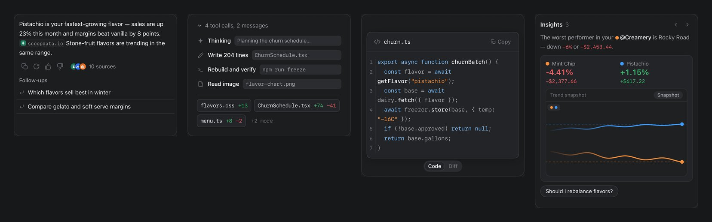

- No third-party dependencies. Components are data-driven and carry no demo data; the ice-cream sample data lives in the Catalog only.
- Light and dark appearance follow the system. Text scales with Dynamic Type. With "Reduce Motion" on, looping animations stop.
- Every component has a side-by-side sheet with the original site in [`compare/`](compare).

## Components

Tap a screenshot for its comparison with the original. Differences from the original are listed in [docs/components.md](docs/components.md).

<table>
<tr><td width="33%" valign="top" align="center"><a href="compare/01-loading-state.jpg"><picture><source media="(prefers-color-scheme: dark)" srcset="docs/images/components/dark/01-loading-state.jpg">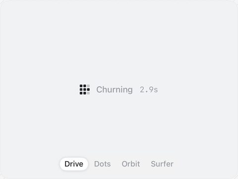</picture></a><br><b>01 Loading State</b><br><sub>Pixel-grid loader with shimmer and elapsed time.</sub></td><td width="33%" valign="top" align="center"><a href="compare/02-thinking-state.jpg"><picture><source media="(prefers-color-scheme: dark)" srcset="docs/images/components/dark/02-thinking-state.jpg">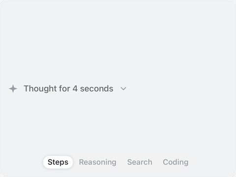</picture></a><br><b>02 Thinking</b><br><sub>Expandable traces: steps, reasoning, search, coding.</sub></td><td width="33%" valign="top" align="center"><a href="compare/03-streaming-text.jpg"><picture><source media="(prefers-color-scheme: dark)" srcset="docs/images/components/dark/03-streaming-text.jpg">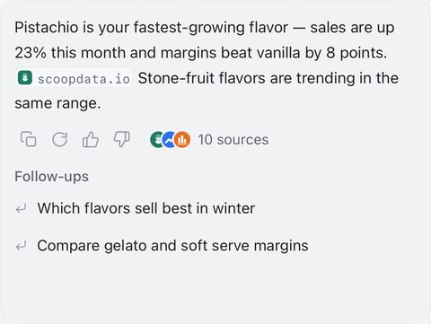</picture></a><br><b>03 Streaming Text</b><br><sub>Streamed answer with inline sources, actions and follow-ups.</sub></td></tr>
<tr><td width="33%" valign="top" align="center"><a href="compare/04-approval-card.jpg"><picture><source media="(prefers-color-scheme: dark)" srcset="docs/images/components/dark/04-approval-card.jpg">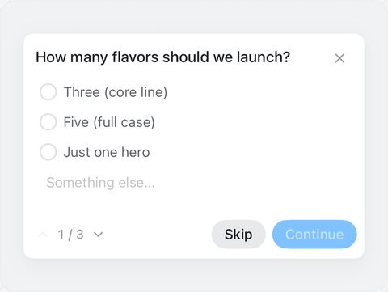</picture></a><br><b>04 Approval Card</b><br><sub>Human-in-the-loop questions the agent asks before acting.</sub></td><td width="33%" valign="top" align="center"><a href="compare/05-tool-chips.jpg"><picture><source media="(prefers-color-scheme: dark)" srcset="docs/images/components/dark/05-tool-chips.jpg">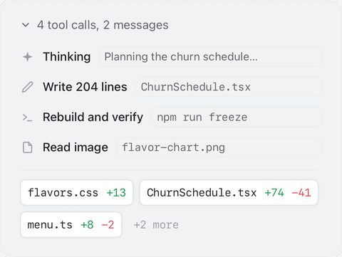</picture></a><br><b>05 Tool Chips</b><br><sub>Code edits and tool calls as compact chips.</sub></td><td width="33%" valign="top" align="center"><a href="compare/06-task-rows.jpg"><picture><source media="(prefers-color-scheme: dark)" srcset="docs/images/components/dark/06-task-rows.jpg">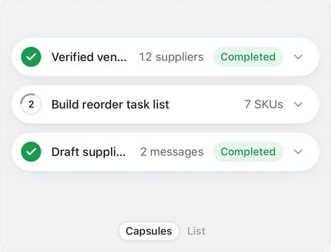</picture></a><br><b>06 Task Rows</b><br><sub>Live agent task status: running, failed, completed.</sub></td></tr>
<tr><td width="33%" valign="top" align="center"><a href="compare/07-chat-composer.jpg"><picture><source media="(prefers-color-scheme: dark)" srcset="docs/images/components/dark/07-chat-composer.jpg">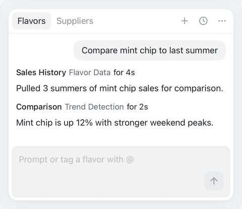</picture></a><br><b>07 Chat</b><br><sub>Tabbed chat panel with reasoning replies and a composer.</sub></td><td width="33%" valign="top" align="center"><a href="compare/08-prompt-bar.jpg"><picture><source media="(prefers-color-scheme: dark)" srcset="docs/images/components/dark/08-prompt-bar.jpg">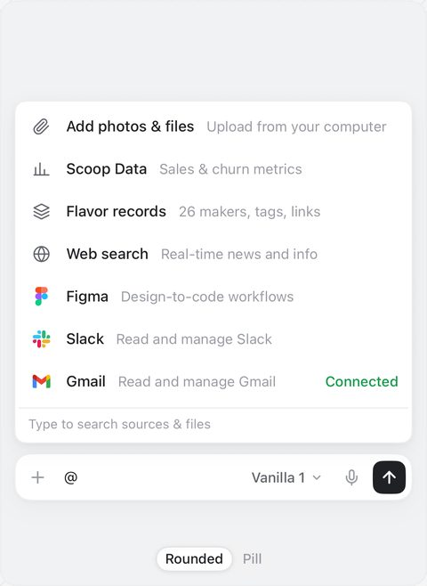</picture></a><br><b>08 Prompt Bar</b><br><sub>Composer with @ sources, / commands, model picker and dictation.</sub></td><td width="33%" valign="top" align="center"><a href="compare/09-recommendation-card.jpg"><picture><source media="(prefers-color-scheme: dark)" srcset="docs/images/components/dark/09-recommendation-card.jpg">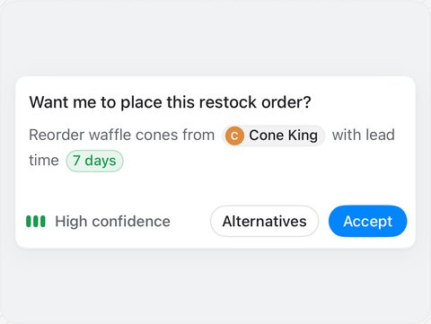</picture></a><br><b>09 Recommendation Card</b><br><sub>Agent suggestion with a confidence meter and actions.</sub></td></tr>
<tr><td width="33%" valign="top" align="center"><a href="compare/10-context-cards.jpg"><picture><source media="(prefers-color-scheme: dark)" srcset="docs/images/components/dark/10-context-cards.jpg">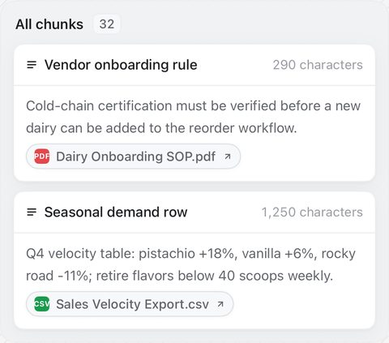</picture></a><br><b>10 Context Cards</b><br><sub>Retrieved knowledge chunks with their sources.</sub></td><td width="33%" valign="top" align="center"><a href="compare/11-diff-table.jpg"><picture><source media="(prefers-color-scheme: dark)" srcset="docs/images/components/dark/11-diff-table.jpg">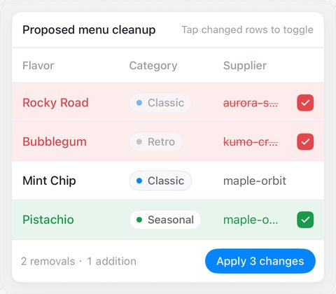</picture></a><br><b>11 Diff Table</b><br><sub>AI-proposed edits sweeping through tabular data.</sub></td><td width="33%" valign="top" align="center"><a href="compare/12-records-table.jpg"><picture><source media="(prefers-color-scheme: dark)" srcset="docs/images/components/dark/12-records-table.jpg">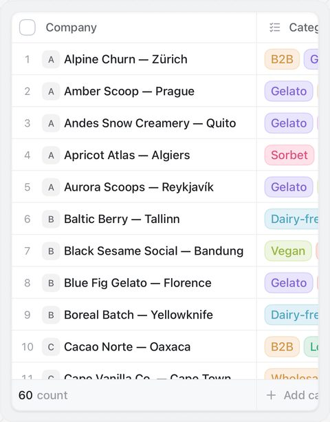</picture></a><br><b>12 Records Table</b><br><sub>CRM-style grid with tags, sorting and relationship status.</sub></td></tr>
<tr><td width="33%" valign="top" align="center"><a href="compare/13-filter-table.jpg"><picture><source media="(prefers-color-scheme: dark)" srcset="docs/images/components/dark/13-filter-table.jpg">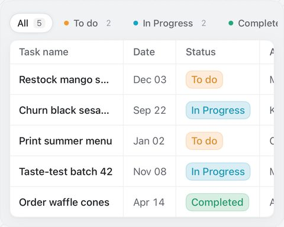</picture></a><br><b>13 Filter Table</b><br><sub>Status chips that reorganize live data.</sub></td><td width="33%" valign="top" align="center"><a href="compare/14-sidebar-nav.jpg"><picture><source media="(prefers-color-scheme: dark)" srcset="docs/images/components/dark/14-sidebar-nav.jpg">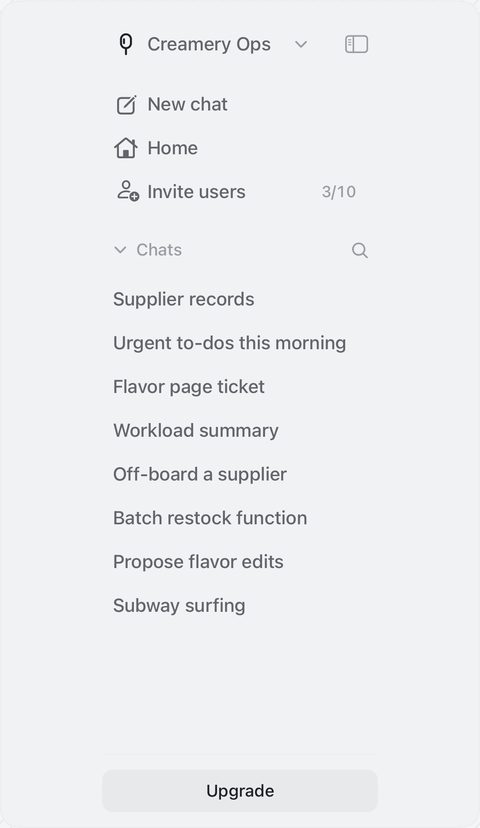</picture></a><br><b>14 Sidebar Nav</b><br><sub>Collapsible workspace and chat navigation.</sub></td><td width="33%" valign="top" align="center"><a href="compare/15-search.jpg"><picture><source media="(prefers-color-scheme: dark)" srcset="docs/images/components/dark/15-search.jpg">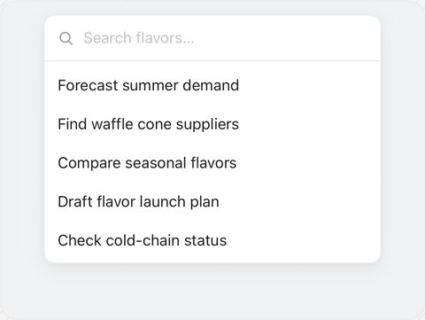</picture></a><br><b>15 Search</b><br><sub>Command search with live filtering and an empty state.</sub></td></tr>
<tr><td width="33%" valign="top" align="center"><a href="compare/16-flowchart.jpg"><picture><source media="(prefers-color-scheme: dark)" srcset="docs/images/components/dark/16-flowchart.jpg">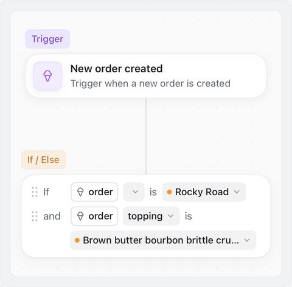</picture></a><br><b>16 Flowchart</b><br><sub>Workflow trigger and condition steps on a dotted canvas.</sub></td><td width="33%" valign="top" align="center"><a href="compare/17-insight-cards.jpg"><picture><source media="(prefers-color-scheme: dark)" srcset="docs/images/components/dark/17-insight-cards.jpg">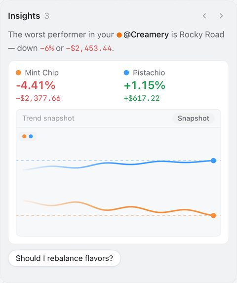</picture></a><br><b>17 Insight Cards</b><br><sub>Paged agent insights with scrub-ready live charts.</sub></td><td width="33%" valign="top" align="center"><a href="compare/18-code-block.jpg"><picture><source media="(prefers-color-scheme: dark)" srcset="docs/images/components/dark/18-code-block.jpg">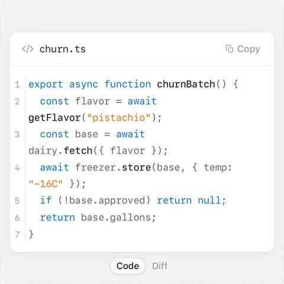</picture></a><br><b>18 Code Block</b><br><sub>A line-numbered listing and a unified diff.</sub></td></tr>
<tr><td width="33%" valign="top" align="center"><a href="compare/19-fine-tune-card.jpg"><picture><source media="(prefers-color-scheme: dark)" srcset="docs/images/components/dark/19-fine-tune-card.jpg">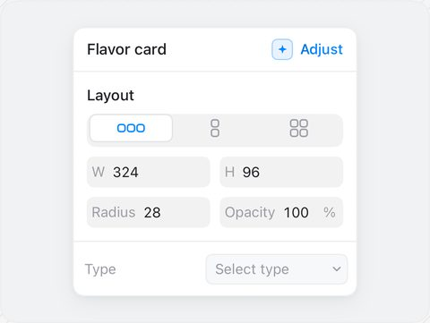</picture></a><br><b>19 Fine-tune Card</b><br><sub>The agent adjusts design properties in an inspector.</sub></td><td width="33%" valign="top" align="center"><a href="compare/20-selection-actions.jpg"><picture><source media="(prefers-color-scheme: dark)" srcset="docs/images/components/dark/20-selection-actions.jpg">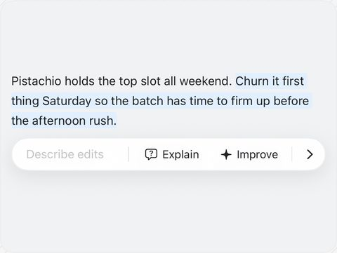</picture></a><br><b>20 Selection Actions</b><br><sub>Highlight a passage and hand it to the agent to rewrite.</sub></td><td width="33%" valign="top" align="center"><a href="compare/21-agent-screen.jpg"><picture><source media="(prefers-color-scheme: dark)" srcset="docs/images/components/dark/21-agent-screen.jpg">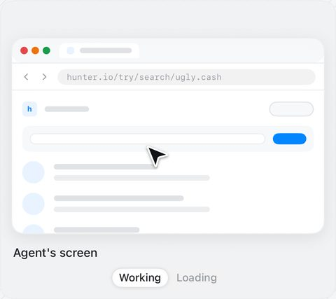</picture></a><br><b>21 Agent Screen</b><br><sub>Watch an agent's screen: open, teach a task, record.</sub></td></tr>
</table>

## Requirements

- iOS 26 or macOS 26 (macOS builds and runs SwiftUI previews)
- Swift 6.2 (Xcode 26)

## Installation

BeautifulUI is distributed with Swift Package Manager.

**Xcode.** Choose File > Add Package Dependencies…, enter the repository URL and add the `BeautifulUI` library to your app target:

```
https://github.com/szupzj18/BeautifulUI
```

**Package.swift.**

```swift
dependencies: [
    // Use `from: "0.1.0"` once the first version is tagged.
    .package(url: "https://github.com/szupzj18/BeautifulUI", branch: "main"),
],
targets: [
    .target(
        name: "MyApp",
        dependencies: [
            .product(name: "BeautifulUI", package: "BeautifulUI"),
        ]
    ),
]
```

To work against a local checkout, add the package by path instead: `.package(path: "../BeautifulUI/BeautifulUI")` (the inner `BeautifulUI` folder holds a manifest of its own).

## Quick start

```swift
import SwiftUI
import BeautifulUI

struct ContentView: View {
    // Mutable state of the prompt bar lives in an @Observable model owned by the host.
    @State private var composer = PromptBarModel(selectedModelID: "sprinkles-5")

    var body: some View {
        ScrollView {
            VStack(alignment: .leading, spacing: 24) {
                // A status line for a long task
                LoadingState("Churning", pattern: .drive)

                // An agent trace, driven by isWorking and the rows that have arrived so far
                ThinkingState(.steps, isWorking: false, doneTitle: "Thought for 4 seconds",
                              rows: [ThinkingRow("Reading flavor briefs"),
                                     ThinkingRow("Writing the scoop report")])

                // A streamed answer: append tokens while isStreaming is true
                StreamingText(tokens: StreamingToken.words("Pistachio is your fastest-growing flavor."),
                              isStreaming: false,
                              followUps: ["Which flavors sell best in winter"],
                              onFollowUp: { prompt, _ in print(prompt) })

                PromptBar(model: composer,
                          commands: [PromptCommand("/compare", detail: "Compare two flavors")],
                          models: [PromptModel(id: "sprinkles-5", name: "Sprinkles 5", tag: "Fast")],
                          onSend: { print($0) })
            }
            .padding()
        }
    }
}
```

Every component lives in the `BeautifulUI` module. The [Catalog](Catalog) has a demo for each one with realistic data.

## Theme and host hooks

Components read a `BUITheme` (colors, radii, type scale) from the environment. The default is the original site's palette; a host replaces it as a whole:

```swift
RootView()
    .buiTheme(BUITheme(colors: myColors, radii: BUIRadii(control: 10, card: 14)))
```

Putting the components into an app that already has its own type size, fonts and lists (`typeScale`, `entrances`, `ToolChipRow`, `ToolChipGroup`, `CodeBlock` diff options) is covered in the docs:

- [Theming](docs/theming.md)
- [Host integration](docs/host-integration.md)
- [Design tokens](docs/tokens.md): the values read from the original site's stylesheet

## Run the Catalog

The Catalog is an iOS app with a gallery of live demos of all 21 components, in the original's order. You need Xcode 26 and [XcodeGen](https://github.com/yonaskolb/XcodeGen) (`brew install xcodegen`).

```sh
cd Catalog
xcodegen generate   # writes Catalog.xcodeproj; the project file is not committed
open Catalog.xcodeproj
```

Pick the `Catalog` scheme and an iPhone simulator, then run.

- The home screen is a gallery that scrolls through every demo on one page (off-screen demos do not animate). The expand button opens one component on its own; the top-right menu switches to a list view.
- Each component page looks like a section of the original site: numbered title, a canvas-colored demo area and variant buttons at the bottom. Replay and next-component buttons sit top right.
- Launch arguments, for screenshots and recordings: `-component <id> -variant <name> -theme dark|light -state <state>`. For example `-component approval-card -state q2` opens the second question of the approval card.
- `Catalog/UITests/WalkthroughTests` is a scripted walkthrough (all 21 components in dark, three more in light). `tools/record-walkthrough.sh` records the screen while it runs.
- `tools/build-catalog.sh` generates, builds and installs the Catalog on a simulator of its own. `tools/compare-all.sh` regenerates every comparison sheet from the current code; the original site's screenshots are not in the repository (they are someone else's content), so a fresh clone can only re-shoot the SwiftUI side.

Run the unit tests with `swift test` (58 tests: curves and keyframes, SVG parsing, per-component state logic).

## Relationship to Beautiful UI

BeautifulUI is a SwiftUI port of [Beautiful UI](https://www.beautifului.dev/), a set of AI-native interface primitives by Turbo. The design tokens, component behavior, copy and demo data are derived from the original, which is Copyright (c) 2026 Shane Levine and released under the MIT License ([`LICENSE-beautifului`](LICENSE-beautifului), [`NOTICE`](NOTICE)). The left-hand columns of the comparison sheets in [`compare/`](compare) are screenshots of the original showcase site.

## Contributing

Bug reports, ideas and pull requests are welcome; start with [CONTRIBUTING.md](CONTRIBUTING.md). Please follow the [Code of Conduct](CODE_OF_CONDUCT.md). To report a security problem, see [SECURITY.md](SECURITY.md). Changes are recorded in [CHANGELOG.md](CHANGELOG.md).

## License

BeautifulUI's own code is released under the MIT License, Copyright (c) 2026 ChrisPan: see [LICENSE](LICENSE). The original project's license is kept in [LICENSE-beautifului](LICENSE-beautifului).

The README is also available in [简体中文](README.zh-CN.md).
